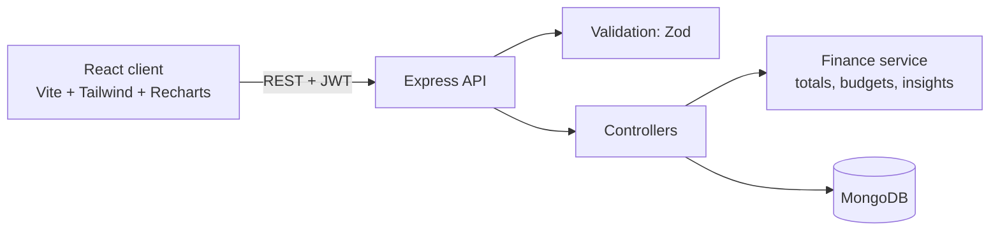

# SpendWise

<<<<<<< HEAD
**Live demo:** https://spendwise-fbzk.onrender.com/budgets
=======
**Live demo:** [https://your-link.onrender.com](https://spendwise-fbzk.onrender.com/budgets)
>>>>>>> d15b90d74c98bb28a43ef2b9345214f4c7775df9
(Free hosting: the first load after a quiet period can take about a minute.)

Full-stack personal expense and budget management platform. Record income and expenses, set monthly category budgets, and get plain-language insights about your spending.

## Overview

SpendWise is a React + Express + MongoDB application. The React client talks to a REST API that validates every request, stores data in MongoDB, and returns pre-computed summaries for the dashboard and charts.

## Problem Statement

Most people know roughly what they earn but not where it goes. SpendWise makes that visible: log a transaction in seconds, see spending by category, and get warned before a budget is exceeded.

## Key Features

- **Accounts**: register and log in with JWT authentication and bcrypt-hashed passwords.
- **Profile**: view and edit your name and email (changing the email needs your password), change your password, export every transaction as CSV, and delete your account.
- **Forgot password**: single-use reset links that expire after 30 minutes. Only a hash of the token is stored, and the endpoint answers the same way whether or not an account exists.
- **Dark mode**: dark, light, or follow-the-system theme, remembered per device, with theme-aware charts.
- **Transactions**: add, edit, delete, search, and filter by date range, category, payment method, type, and amount, with pagination.
- **Budgets**: monthly limit per category, with progress bars that turn amber at 80% and red at 100%.
- **Dashboard**: income, expenses, balance, savings rate, category breakdown, budget status, and recent activity for any month.
- **Analytics**: income vs expenses trend and a stacked category chart for the last 3, 6, or 12 months.
- **Rule-based insights**: for example "Your Travel expenses increased by 18% compared with last month." These are computed from your data with fixed rules; there is no AI involved.

## Technology Stack

| Layer    | Tools                                                                  |
| -------- | ---------------------------------------------------------------------- |
| Frontend | React 18, Vite, React Router, Tailwind CSS, Recharts                   |
| Backend  | Node.js, Express 4, Zod (validation), Helmet, CORS, express-rate-limit |
| Database | MongoDB with Mongoose                                                  |
| Auth     | JSON Web Tokens, bcryptjs                                              |
| Tests    | Node's built-in test runner                                            |
| CI       | GitHub Actions                                                         |

## System Architecture



Every protected route reads the user id from the verified JWT, never from the request body or URL. All queries include `userId`, so one user can never read, edit, or delete another user's data.

## Database Design

**User**: `name`, `email` (unique), `passwordHash` (never returned by queries)

**Transaction**: `userId`, `type` (income | expense), `amount`, `category`, `description`, `paymentMethod`, `date`. Index on `(userId, date)`.

**Budget**: `userId`, `category`, `monthlyLimit`, `month` (`YYYY-MM`). Unique index on `(userId, category, month)`.

Calculations:

- Balance = total income − total expenses
- Utilization = category spending ÷ monthly limit × 100

Money is summed in integer paise inside the finance service to avoid floating-point errors, and month ranges are half-open UTC intervals, so a transaction on the 1st is never counted twice.

## Installation and Setup

Requirements: Node.js 18+ and a MongoDB instance (local, or a free MongoDB Atlas cluster).

```bash
git clone https://github.com/YOUR_USERNAME/SpendWise.git
cd SpendWise
npm run install:all

cp server/.env.example server/.env   # then edit the values
npm run seed                          # optional: demo data
npm run dev:server                    # terminal 1, http://localhost:5000
npm run dev:client                    # terminal 2, http://localhost:5173
```

Demo login after seeding: `demo@example.com` / `demo12345`.

## Environment Variables

See `server/.env.example`.

| Name             | Purpose                                                                                                                             |
| ---------------- | ----------------------------------------------------------------------------------------------------------------------------------- |
| `PORT`           | API port (default 5000)                                                                                                             |
| `MONGODB_URI`    | MongoDB connection string                                                                                                           |
| `JWT_SECRET`     | Long random string used to sign tokens                                                                                              |
| `JWT_EXPIRES_IN` | Token lifetime (default 7d)                                                                                                         |
| `CLIENT_ORIGIN`  | Allowed CORS origin for the client                                                                                                  |
| `APP_URL`        | Optional. Base URL used in password-reset links (defaults to `CLIENT_ORIGIN`)                                                       |
| `RESEND_API_KEY` | Optional. Enables real reset emails via resend.com. Without it, the reset link is printed in the server terminal (development only) |
| `MAIL_FROM`      | Optional. Sender address for reset emails                                                                                           |

## API Documentation

All routes are under `/api`. Everything except `/health`, `/auth/register`, and `/auth/login` requires `Authorization: Bearer <token>`.

| Method | Endpoint                           | Description                                                                                                    |
| ------ | ---------------------------------- | -------------------------------------------------------------------------------------------------------------- |
| GET    | `/health`                          | Health check                                                                                                   |
| POST   | `/auth/register`                   | Create account. Body: `name`, `email`, `password` (8+ chars)                                                   |
| POST   | `/auth/login`                      | Log in. Returns `token` and `user`                                                                             |
| POST   | `/auth/forgot-password`            | Request a reset link. Body: `email`                                                                            |
| POST   | `/auth/reset-password`             | Set a new password. Body: `token`, `password`                                                                  |
| GET    | `/auth/me`                         | Current user and counts of transactions and budgets                                                            |
| PATCH  | `/auth/profile`                    | Update `name` and/or `email` (email change needs `currentPassword`)                                            |
| POST   | `/auth/change-password`            | Body: `currentPassword`, `newPassword`                                                                         |
| DELETE | `/auth/account`                    | Delete account and all its data. Body: `password`                                                              |
| GET    | `/transactions/export`             | Download all transactions as CSV                                                                               |
| GET    | `/transactions`                    | List. Query: `q`, `type`, `category`, `paymentMethod`, `from`, `to`, `minAmount`, `maxAmount`, `page`, `limit` |
| POST   | `/transactions`                    | Create. Body: `type`, `amount`, `category`, `date`, `description?`, `paymentMethod?`                           |
| PATCH  | `/transactions/:id`                | Edit any subset of fields                                                                                      |
| DELETE | `/transactions/:id`                | Delete                                                                                                         |
| GET    | `/budgets?month=YYYY-MM`           | Budgets with spent, remaining, utilization, and status                                                         |
| POST   | `/budgets`                         | Create or update. Body: `category`, `month`, `monthlyLimit`                                                    |
| DELETE | `/budgets/:id`                     | Delete                                                                                                         |
| GET    | `/dashboard/summary?month=YYYY-MM` | Totals, categories, budgets, insights, recent transactions                                                     |
| GET    | `/analytics/monthly?months=6`      | Month-by-month income, expenses, and category spend                                                            |

Errors return `{ "message": "...", "details": [...] }` with a suitable status code (400 validation, 401 auth, 404 not found, 409 duplicate).

## Screenshots

Add screenshots to `docs/` after running the app and link them here:

```md

```

## Testing

```bash
npm test
```

The unit tests in `tests/` cover totals, floating-point handling, budget utilization and status thresholds, month boundaries, insight generation, and CSV escaping (including spreadsheet-formula injection).

Tested manually with Postman or curl before relying on it: registration, login, and the ownership checks (try using user A's token on user B's transaction id and confirm you get 404).

## Known Limitations

- No automated API or UI tests yet; only the finance logic is unit tested.
- The JWT is stored in `localStorage`, which is simple but exposed to XSS. An httpOnly cookie would be stronger for production.
- Real reset emails need an email service key (`RESEND_API_KEY`) and, for most providers, a verified sender domain. Without one, links are only printed to the server terminal.
- No email verification or refresh tokens. Changing a password does not sign out other devices; their tokens stay valid until they expire (7 days).
- Single currency (INR) and no recurring transactions.
- Not deployed.

## Future Enhancements

- API integration tests with `supertest` and `mongodb-memory-server`
- Recurring transactions, CSV import/export
- Deployment (client on Vercel/Netlify, API on Render/Railway, MongoDB Atlas)
- Optional AI-written insight summaries

## License

MIT
